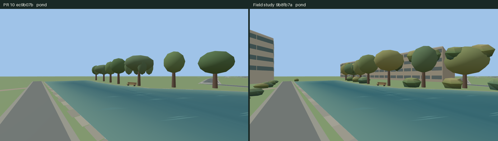

# 인경호·아고라 현장사진 대조와 플레이 검증

2026-11-23. 인경호 양안에 시설 원장의 학생회관과 2호관 남관 외곽을 세우고, 둑에 겹치는 수관과 보행로 옆 관목을 더했다. 물가에 서면 수면 너머로 두 건물의 윤곽이 이어진다. 비교 기준은 작업 시작 때의 `ec9b07b`, 맵 구현은 `29f084a`, 최종 렌더·입력 검증 대상은 `9b8fb7a`다. PR #10과 base인 PR #7은 모두 열린 Draft였고 base HEAD는 `c536c73`이었다. [맵 구현](https://github.com/aldol2678/inhaworld/commit/29f084a6bc4cf052382d68525776f3a86b0781ae) · [렌더 최적화](https://github.com/aldol2678/inhaworld/commit/9b8fb7a0329fcd63de6d5a86be5c4a61105fae07) · [PR #10](https://github.com/aldol2678/inhaworld/pull/10) · [ARK 인계](https://github.com/aldol2678/inhaworld/pull/10#issuecomment-7089525068)



## 사진과 게임에서 확인한 범위

모아 원본 PDF 76쪽의 사진 번호 68개를 분류표와 대조하고 ARK가 지정한 우선 사진 8장을 확대해 검토했다. 사진의 카메라 위치·방위·렌즈 보정값은 미상이다. 아래 고정뷰는 두 게임 버전 사이에서 일치하며, 사진과는 상대적인 형태와 가림 관계를 비교한다. 원본 PDF SHA-256은 `a9c7557d8779529caf6b9aac15bf0df919d4a7106e2ec99706666c88fa88c326`이다. 게임 에셋은 저장소의 절차 기하와 색으로 만들었다. [원본 PDF](https://drive.google.com/file/d/1BUc_dwW6ugZ_4sZHQUqLIuPO3mEl0E8A/view) · [68장 분류표](https://docs.google.com/spreadsheets/d/1Hgj_Qiyr_-EWfW6DxZ2wTU5OaB9ELGQI/edit) · [ARK 대조 보고서](https://docs.google.com/document/d/1rLeZsskkzRVrQzebvnxYap7MxvLynt3I/edit) · [사진 68장별 수정 파일·화면·테스트 대응표](photo-crosswalk.csv)

| 사진 / PDF 쪽 | 현장 관찰과 구현 판단 | 전후 화면 |
|---|---|---|
| #1 / 3 | 수면 뒤의 건물과 높이가 다른 수관을 보강했다. 용 조형물은 위치·권리 확인 대기다. | [동측 눈높이](screens/pond.png) |
| #2 / 4 | 긴 직선 호안과 맞은편 굴곡, 도로의 상대 위치를 부감으로 비교했다. 수변석은 원래 경계에서 인접 조각끼리 끝점을 공유한다. | [수직 부감](screens/lake-plan.png) |
| #3 / 5 | 굽은 건물 입면과 수목의 겹침을 대조했다. 학생회관 원장의 굴곡을 따라 창띠가 돌아간다. 건물 식별은 시설 원장과 OSM 명칭에 근거한다. | [건너편 눈높이](screens/west-bank.png) · [사선 부감](screens/lake-oblique.png) |
| #4 / 6 | 중앙 잔디광장과 긴 수로의 양안 산책축이다. 수로 세부는 P1B 후보로 남겼다. | [중앙 수로](screens/canal.png) |
| #5 / 7 | 같은 중앙 수로를 더 넓게 담은 사진이다. 광역 건물·식재 조사는 P1B에서 다룬다. | [중앙 수로 가로](screens/canal-landscape.png) |
| #12 / 15 | 겨울에도 구분되는 인경호 옆 입면의 굴곡과 수목 층위를 참고했다. 정확한 층고·타워 높이와 적설 연출은 보류했다. | [사선 부감 가로](screens/lake-oblique-landscape.png) |
| #15 / 18 | #2와 반대 방향에서 보이는 직선변·굴곡을 대조했다. 얼음과 눈이 가장자리를 가려 정밀 윤곽 판정은 HOLD다. | [수직 부감 가로](screens/lake-plan-landscape.png) |
| #19 / 22 | 눈 덮인 중앙 수로 양측의 동선과 식재 간격이다. 아고라에는 직접 촬영 근거가 더 필요하다. | [중앙 수로](screens/canal.png) |

## 건물·녹지·보행로

- 학생회관 `bldg_07`은 OSM 218038027 v6의 29점, 2호관 남관 `bldg_02_south`는 219983082 v8의 21점을 시설 원장과 직접 대조했다. 두 건물의 원장 높이 13·11 WU는 표현값이다. 창띠 높이·폭·색과 층별 외관도 표현 추정이다. 먼 거리에서는 같은 외곽과 지붕을 유지하고, 인경호 중심에서 110 WU 안에 들어오면 창띠와 식재 세부를 그린다. [시설 원장](../../../map-sources/data/reality/campus-facilities.json) · [건물 생성 코드](../../../tools/inkyung-buildings.mjs) · [OSM 학생회관](https://www.openstreetmap.org/way/218038027) · [OSM 2호관 남관](https://www.openstreetmap.org/way/219983082)
- 비룡플라자 입구1 노드 `9767122969`는 학생회관 외곽과 기존 보도의 공통 끝점이다. 건물 외벽 충돌 2개를 추가하고, 입구 바닥에는 플레이어 캡슐이 도착·회전할 자리를 두었다. 게임의 1.10 WU 후퇴량은 출입구 실측값으로 쓸 수 없다. 기존 충돌체 153개, 수목 줄기 68개, 길 10개, 서비스 방 3개의 데이터는 기준 커밋과 일치한다. [입구 노드](https://www.openstreetmap.org/node/9767122969) · [출입구·호안 회귀](../../../tests/p1a-spatial.mjs)
- 기존 호안 수목 8주의 수관을 서로 다른 높이로 겹치고 둑과 보행로의 마른 녹지에 낮은 관목을 배치했다. 수종·개체 수·식재 위치는 게임 표현이다. 수변석은 육지 쪽으로만 이어지며 물·포장·보도 소유면에서 잘린다. 원장의 서비스도로 2.04 WU, 보도 1.24 WU, 가장자리 0.22 WU는 기존 렌더 폭이다. [녹지·수변석 생성 코드](../../../tools/agora-inkyung.mjs) · [동측 접근로 원장](../../../map-sources/data/reality/evidence/roads/agora-inkyung.json)
- 아고라 1099894035 v1의 7점, 포장·벤치·나무 보호대와 중앙 수로의 공간 배치를 보존했다. 아고라 전후 화면에서 달라진 큰 윤곽은 광장 밖 학생회관과 호안 수관이다. [아고라](screens/agora.png) · [아고라 모바일](screens/agora-landscape.png) · [OSM 광장](https://www.openstreetmap.org/way/1099894035)

## 공간 검증

OSM API에서 직접 받은 인경호 218264623 v7의 13개 고유 노드와 원장 순서·WGS84 값이 모두 일치했다. 굽은 서측과 긴 동측 사선의 관계를 #2·#15와 육안 대조했다. 동측 481241663 v3의 첫 3개 노드와 1063267429 v2의 2개 노드도 원장에 일치했다. 호수 충돌 폴리곤과 두 길 중심선의 투영 오차는 각각 0 WU였다. 사진으로부터 꼭짓점별 위치 오차를 추정하려면 촬영 자세나 독립 측량 기준점이 필요하다. [OSM 재조회 결과](osm-results.json) · [재조회 코드](check_osm.py) · [© OpenStreetMap contributors](https://www.openstreetmap.org/copyright)

바이너리 삼각형을 원장 호수 폴리곤에 다시 잘라 계산했다. PR #7의 마른 지면 침범 7.372060 WU², 착수 기준 0.000141 WU², 개선 빌드 근경 0.000163 WU²·원경 0.000080 WU²였다. 허용 오차는 0.002 WU²다. 근경 수면 면적은 707.533619 WU²이며 원장 면적은 707.533775 WU²다. 각 변에서 지상 캡슐을 수면 안쪽으로 이동시키면 13/13 모두 변 바깥 0.60001 WU에 멈췄다. 두 접근로 전체 길이의 101개 표본씩을 구간별로 검사했고, 아고라 벤치 두 개와 서측 벤치의 접촉도 검사했다. [측정값](qa-results.json)

독립 모아 포트의 WGS84 174점도 최대 차이 0 WU였다. 포트 입력으로 재생성한 `layout.json`과 `layout.bin`은 체크인한 두 파일과 바이트 단위로 일치했다. 독립 입력 `campus-data.js`의 SHA-256은 `3a214c4f4875d551cc7120b62c50ae5ca7c41e237adc7a5e6740c3f461272c44`다. [모아 포트가 포함된 인계 패킷](https://drive.google.com/file/d/1HsjR6qXDZDMItoL7GgMPF1tWl1d9tWpo/view)

## 로컬 플레이와 기능 회귀

Node 24.22.3과 npm 11.19.1에서 설치·빌드·테스트와 `build-layout --check`를 실행했다. 독립 체크아웃에서 다시 빌드한 정적 파일 17개는 모두 SHA-256이 같았다. Node 테스트 10개와 충돌 이동 74건을 통과했다. 퀘스트·방·인증·저장 코드와 Worker 4개 트리 및 DB 스키마는 기준 커밋과 일치한다. [재현 명령](#재현) · [검증 기록](qa-results.json)

Chrome for Testing 151.0.7922.34, Python 3.12.14, Playwright 1.62.0, pytest 9.2.0으로 게임의 키보드·터치 이벤트, 렌더러와 충돌을 실행했다. 정문에서 아고라를 거쳐 호수 동측과 곁보도 끝까지 걸은 뒤 같은 정문 스폰으로 복귀했다. 각 화면에서 39개 이동 입력, 1,492 게임 프레임을 진행했다. 둑 접촉 후 대각 입력으로 5 WU가량 미끄러져 이동했다. [PC 실제 도착 화면](screens/walk-1280x720.png) · [모바일 가로 실제 도착 화면](screens/walk-891x411.png)

| 뷰포트 | 입력 | 실제 캔버스 | 자유 이동 최대 오차 | 정문 복귀 (x, z) |
|---|---|---|---:|---|
| 1280×720 | 마우스 포인터 잠금·WASD | 940×504 | 0.100 WU | (0, −98) |
| 891×411 | 터치 조이스틱·오른손 시점 | 891×288 | 0.080 WU | (0, −98) |
| 844×390 | 터치 | 844×273 | 0.080 WU | (0, −98) |
| 390×844 | 터치 | 390×473 | 0.080 WU | (0, −98) |
| 320×568 | 터치 | 320×318 | 0.080 WU | (0, −98) |

최종 빌드의 브라우저 테스트 20개가 모두 통과했다. 방 세 곳의 방문·퀘스트 3/3, 방명록, 닉네임·기존 저장 키·진행도의 새로고침 복원, 인증 401/503 시 게스트 부팅, 세션 복구·로그아웃, 동기화 403 거부를 확인했다. 독립적으로 ZIP 빌드를 풀어 일반 게임 프레임으로 실행한 PC와 가로 터치에서도 외부 요청·페이지 오류 없이 이동했다. [테스트 목록과 왕복 기록](qa-results.json)

처음 추가한 보조 수관은 호수 위로 투영되어 마른 삼각형 검사에서 6.322 WU²가 검출됐다. 토지 마스크 안에 수관을 배치한 뒤 같은 검사를 통과했다. 첫 전체 브라우저 검사에서는 도서관 후퇴 후 포인터 해제 대기 1건이 시간 초과됐다(19/20). 마지막 렌더 프레임을 표시한 뒤 잠금 해제를 요청하고 브라우저의 실제 해제를 기다리도록 재생 도구를 조정했다. 최종 전체 검사에서는 실패 0건이었고, 설치 환경의 AnyIO pytest 플러그인에서 폐기 예정 API 경고 1건이 기록됐다. 별도 연속 클릭 검사에서는 기준·개선 양쪽 모두 짧은 시간 내 다섯 번째 포인터 잠금 요청을 Chromium이 `NotAllowedError`로 제한했다. 35초 뒤 새 클릭으로 양쪽 모두 잠금·해제에 성공했다.

## 화면과 렌더 비용

두 빌드를 Debian Chromium 156.0.8078.79, SwiftShader WebGL2, DPR 1, 수직 FOV 70°로 촬영했다. 지상 카메라 높이는 2.2 WU다. 부감은 캡처 도구에서만 카메라 높이와 피치를 고정했다. 9개 시점 × 2개 뷰포트의 18개 전후 쌍마다 위치·회전·FOV·캔버스 크기를 검사했다. 각 쌍의 왼쪽이 착수 기준이다. 눈높이 인경호에서 색 채널 하나라도 8/255를 초과해 달라진 픽셀은 PC 84,883개, 가로 모바일 75,471개였다. 같은 기준에서 PC 본관과 정석은 각 0개였고, 중앙 수로는 383개였다. [카메라·원본 PNG 해시·픽셀 차이](camera-results.json) · [PC](screens/pond.png) · [가로 891](screens/pond-landscape.png)

| 같은 카메라·예열 조건 | `ec9b07b` | `9b8fb7a` |
|---|---:|---:|
| PC 인경호 드로우콜 / 프레임당 제출 삼각형 | 3 / 17,501 | 3 / 17,330 |
| 891×411 인경호 드로우콜 / 제출 삼각형 | 4 / 19,021 | 4 / 18,850 |
| PC 정문 원거리 드로우콜 / 제출 삼각형 | 5 / 17,979 | 5 / 17,968 |
| 예열한 WebGL geometry / texture / buffer 수 | 5 / 1 / 19 | 5 / 1 / 19 |
| WebGL 정점·인덱스 등 버퍼 저장소 합계 | 1,423,104 B | 1,356,110 B |
| 빌드의 `layout.bin` / `layout.json` | 623,712 / 127,010 B | 713,808 / 129,589 B |

근경 세부를 기존 정적 배치에 넣고, 원경에는 주 수관과 건물 외곽을 남긴다. 정적 건물과 바닥에는 기존 태양·하늘 조명을 받는 무광 확산 재질을 썼다. 줄기의 가려진 양끝 면을 생략하고 정적 법선은 정규화된 16비트 정수로 저장한다. 이 변경으로 다운로드용 두 맵 파일의 합은 92,675 B 증가했고, 예열 시 관측한 WebGL 버퍼 저장소는 66,994 B 감소했다. 24번의 근·원거리 전환과 새로고침 뒤에도 GPU 객체 수·버퍼 바이트가 같았다. 이 수치는 브라우저가 할당한 버퍼를 세며 물리 GPU 전체 메모리와는 측정 범위가 다르다. [시점별 수치](camera-results.json)

| 인경호 동기 렌더 시간 | 기준 중앙값 / p95 | 개선 중앙값 / p95 |
|---|---:|---:|
| PC 1280×720 | 21.55 / 38.4 ms | 17.20 / 35.4 ms |
| 모바일 가로 891×411 | 15.35 / 33.5 ms | 15.40 / 34.7 ms |

같은 PC의 소프트웨어 WebGL에서 같은 카메라를 예열하고 프레임마다 렌더 뒤 1픽셀을 동기 읽기했다. 기기 설정별로 기준→개선→개선→기준 순서로 측정해 빌드당 120개 표본을 모았다. 모바일 중앙값은 0.05 ms, p95는 1.2 ms 늘었다. 강제 GC 후 JS 사용 힙은 PC 기준 4.11~4.12 MB, 개선 4.10 MB였고 모바일은 기준 4.14~4.15 MB, 개선 4.12~4.14 MB였다. 실제 휴대폰 프레임 시간은 별도 측정 대상이다. [원시 표본·힙·요약](render-times.json)

## 남은 현장 고증

| 우선순위 | HOLD / 후속 작업 | 판단에 필요한 자료 |
|---|---|---|
| 1 | H08 아고라 포장·벤치·나무 보호대 | 광장 안 네 방향과 높은 시점의 사진, 시설 배치 기준점. 광장 7점은 현 상태로 두었다. |
| 2 | H01·H04 호안과 보도 폭·단면 | 방위·렌즈가 알려진 항공 영상 또는 현장 기준점, 물가와 포장 양끝의 횡단 실측. 사진 #2와 #15 사이에는 계절·방향 차이가 있다. |
| 3 | H02·H03 정밀 입면·조경 | 학생회관·2호관의 실측 높이와 입면, 다른 원경 건물의 식별, 수목 조사. 현재 높이·식재는 게임 표현이다. |
| 4 | H06 중앙 수로 P1B | #4·#5·#19를 기준으로 양안 동선, 식재 간격, 수로 단면과 원경을 별도로 조사한다. |
| 5 | H05 정자 / H07 용 조형물 | #2·#15·#30의 정자와 #1의 조형물 각각의 위치·규모, 촬영·모델 사용 권한. 이번 빌드에는 두 구조물을 추가하지 않았다. |

물리 Android/iOS 입력·FPS·발열, 운영 Firebase 실계정·계정 복구와 운영 DB 지속성은 HOLD다. 브라우저 인증·동기화 회귀는 격리된 로컬 응답을 사용했다.

## 재현

아래 명령은 저장소의 `apps/world-client`에서 실행한다. 입력 회귀에는 Chrome for Testing 경로를, 고정뷰에는 양쪽에서 같은 Chromium 경로를 지정한다. QA ZIP의 `play/`는 이미 빌드된 게스트 클라이언트다. ZIP을 푼 디렉터리에서 `python3 -m http.server 8080 --bind 127.0.0.1 --directory play`를 실행하고 `http://127.0.0.1:8080`을 열면 플레이할 수 있다.

```sh
npm ci --ignore-scripts
npm run build
npm test
node tools/build-layout.mjs --check
MOA_CAMPUS_DATA="$PORT_DATA" node tools/build-layout.mjs --check
MOA_CAMPUS_DATA="$PORT_DATA" node tests/spatial.mjs
python3 qa/p1a/field-study/check_osm.py
CHROMIUM="$CHROME_FOR_TESTING" WORLD_QA_DIR="$OUT/input" python3 -m pytest -q tests
```

`BASE_DIST`는 `ec9b07b`에서 빌드한 `dist/`다. 고정뷰에 `--timing`을 더하면 인경호에서 12회 예열 후 렌더·1픽셀 동기 읽기 60회의 원시 소요 시간을 수집한다. 기준→개선→개선→기준 순서로 PC와 가로 모바일을 각각 측정한다.

```sh
export CHROMIUM="$CAPTURE_CHROMIUM"
python3 qa/p1a/capture.py "$BASE_DIST" "$OUT/before-pc" --field-study
python3 qa/p1a/capture.py dist "$OUT/after-pc" --field-study
python3 qa/p1a/capture.py "$BASE_DIST" "$OUT/before-mobile" --field-study --width 891 --height 411
python3 qa/p1a/capture.py dist "$OUT/after-mobile" --field-study --width 891 --height 411
python3 qa/p1a/compare.py "$OUT/before-pc" "$OUT/after-pc" "$OUT/before-mobile" "$OUT/after-mobile" "$OUT/comparison" --before-label ec9b07b --after-label 9b8fb7a
```
